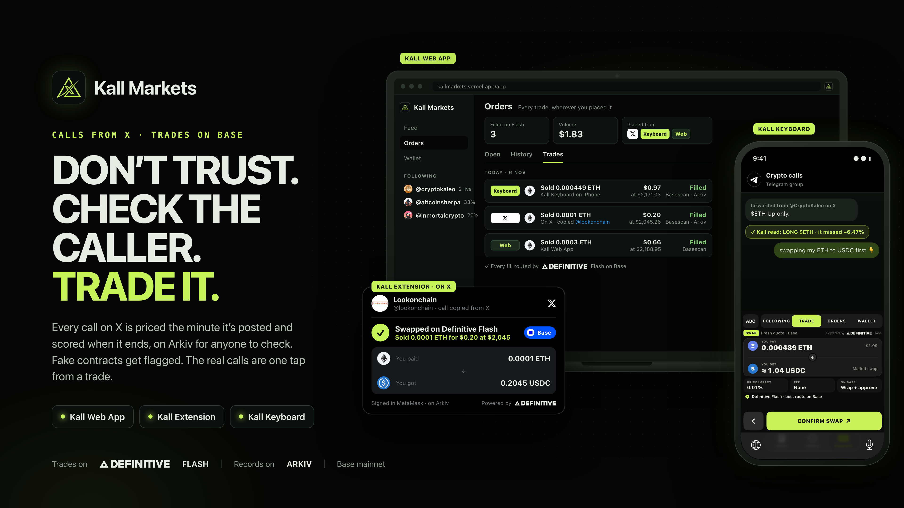
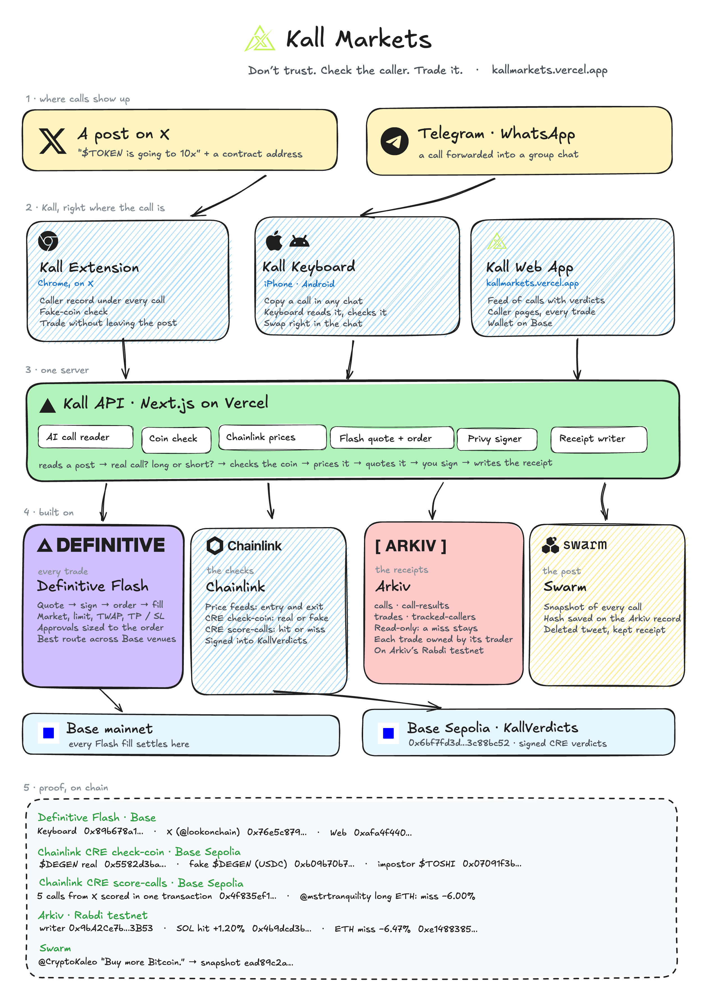

<p align="center"></p>

#  Kall Markets

**Don't trust. Check the caller. Trade it.**

**[kallmarkets.vercel.app](https://kallmarkets.vercel.app)** · [Android app (APK)](https://kall-markets-downloads-308324916322.s3.ap-south-1.amazonaws.com/apps/kall-keyboard.apk) · Built at ETHGlobal Mumbai 2026 · Not financial advice

## Why we built it

Crypto runs on calls. Someone posts "$ETH, be more bullish" to 300,000 followers, and money moves. If it works,
it becomes a screenshot and an ad for a paid group. If it fails, the post quietly disappears. Followers only see
the wins, and in the replies a "contract address" for the coin is waiting: one wrong paste and the money is gone.

The biggest version of this so far: in February 2025, Argentina's president posted the $LIBRA memecoin and its
contract address on X. It shot up to billions, then crashed more than 90%; 86% of the people who bought it lost
money, about $251M, while insider wallets cashed out. Hours later
[the post was deleted](https://www.web3isgoinggreat.com/single/milei-memecoin-promotion). Smaller KOLs do the
same thing every week: shill, dump, delete, and the next call starts from a clean timeline.

We had already built an extension that let you trade straight from a post on X. Watching people use it, the
trade was the easy part. The first question was always: *is this person ever right?* Nobody could answer,
because the only record lives on the caller's own timeline, where they decide what survives.

So before you can trade a call, Kall Markets shows its receipt.

## What it is

One product, wherever calls show up:

| | Where | What you do |
| --- | --- | --- |
| **Kall Extension** | Chrome, on X | A card under every call: the caller's record, a fake-contract check, and a trade you sign without leaving the post |
| **Kall Keyboard** | iPhone and Android, in any chat | Copy a call in Telegram, WhatsApp or X; the keyboard reads it, checks the coin, and trades it in the chat |
| **Kall Web App** | [kallmarkets.vercel.app/app](https://kallmarkets.vercel.app/app) | The feed of real calls with their verdicts, the callers you follow, your trades from all three places, your wallet |

## Architecture

<p align="center"></p>

Editable source: [`docs/architecture.excalidraw`](docs/architecture.excalidraw) (open it at excalidraw.com).

Three apps, one server, three rails. Every call goes down the same line:

1. **Read.** An AI reader decides whether a post is a real call, long or short, and which coin. Sarcasm,
   questions and hindsight don't count.
2. **Check the coin.** Chainlink CRE's `check-coin` workflow: every node reads the contract's symbol on Base and
   asks which Base token is the real one for that ticker. They must agree; the signed verdict goes to our
   `KallVerdicts` contract. A fake coin gets "Call check failed" and no trade.
3. **Price.** Entry is the Chainlink price feed on Base at the minute of the post.
4. **Trade.** Definitive Flash quotes (price impact, slippage and fee shown first), you sign, it fills on Base,
   and you get the Basescan transaction and the route Flash took.
5. **Record.** The call and the trade are written to Arkiv as read-only records; the post is snapshotted to Swarm,
   so deleting the tweet doesn't delete the record.
6. **Score.** When the call's time is up, CRE's `score-calls` workflow takes the price at the post and at the
   deadline across nodes, signs a hit or a miss with its real return, and the caller's record updates in all
   three apps.

| Sponsor | What it does in Kall | Code |
| --- | --- | --- |
| **Definitive Flash** | Every trade: market, limit, TWAP, take-profit and stop-loss. Approvals sized to the order, never unlimited; the API key never leaves the server | **[docs/DEFINITIVE.md](docs/DEFINITIVE.md)** · [`definitive.ts`](packages/integrations/src/definitive.ts), [`/api/flash`](kallr-webapp/app/api/flash) · [our feedback](feedback/definitive.md) |
| **Chainlink** | Price feeds on Base for entry and exit prices; CRE workflows for coin checks and call scores, written to `KallVerdicts` on Base Sepolia | **[docs/CHAINLINK.md](docs/CHAINLINK.md)** · [`kall-cre/`](kall-cre), [`/api/cre`](kallr-webapp/app/api/cre) |
| **Arkiv** | Calls, results, trades and tracked callers as read-only entities anyone can query; each trade owned by its trader | **[arkiv/README.md](arkiv/README.md)** · [`arkiv.ts`](packages/integrations/src/arkiv.ts) |

Also: Swarm (post snapshots), Privy (sign in with X, embedded wallet on Base), GoPlus and Dexscreener (token checks).

## Proof: the real transactions

**Definitive Flash, Base mainnet.** One trade from each app, all filled:

| From | Trade | Fill on Base | Route |
| --- | --- | --- | --- |
| Kall Keyboard (iPhone) | Sold 0.000449 ETH for $0.97 at $2,171.03 | [`0x89b678a1…`](https://basescan.org/tx/0x89b678a1f56a290db3976813b14d83c9799ee3ad5a6fc63e17287e6c35a8a0f1) | Uniswap v2 |
| Kall Extension on X, copying @lookonchain | Sold 0.0001 ETH for $0.20 at $2,045.26 | [`0x76e5c879…`](https://basescan.org/tx/0x76e5c879019ee12da786b34831c0f114012959cb4d8fc798438f5ce1a1c1b24e) | Uniswap v2 |
| Kall Web App | Sold 0.0003 ETH for $0.66 at $2,188.95 | [`0xafa4f440…`](https://basescan.org/tx/0xafa4f4403abd459f9ddd51feda70b8dc5211518e92765a7c43061d3fdfc1e5db) | Uniswap v3 |

**Chainlink CRE, Base Sepolia.** Everything lands in `KallVerdicts` at
[`0x6bf7fd3d…3c88bc52`](https://sepolia.basescan.org/address/0x6bf7fd3d5fa88090f30293aabf81565c3f88bc52),
signed by the workflow and written through Chainlink's forwarder.

`check-coin`: is the coin in the post the real one?

| Claimed | Contract checked | Verdict | Transaction |
| --- | --- | --- | --- |
| $DEGEN | `0x4ed4…efed` (DEGEN) | Real | [`0x5582d3ba…`](https://sepolia.basescan.org/tx/0x5582d3ba9fa5515c5161273941e7933b009f8c194b32b2d1d82cc9a3bc991954) |
| $DEGEN | `0x8335…2913` (that's USDC) | Fake: wrong coin | [`0xb09b70b7…`](https://sepolia.basescan.org/tx/0xb09b70b744b238884270835d76dba63764c88e73148f1fc00e5cf16aae97d39f) |
| $TOSHI | `0x8544…4a8c` | Fake: impostor, real one is `0xac1b…b2b4` | [`0x07091f3b…`](https://sepolia.basescan.org/tx/0x07091f3be329eae796dd14d9319b42aeeabd8394594b550590492b96e73d3002) |
| $TOSHI | `0xac1b…b2b4` (TOSHI) | Real | [`0x694d07a3…`](https://sepolia.basescan.org/tx/0x694d07a3c4a5d1fea84e7df551a2859b08663173732be5862bb052532e3f448c) |

`score-calls`: did the call hit? Five calls from X, priced at the minute of the post and at the deadline, all
scored in one transaction, [`0x4f835ef1…`](https://sepolia.basescan.org/tx/0x4f835ef109633c0f4ee7d7e4761add4ac352be6f79d4963ffab2a8c7be7210d4):

| Post on X | Call | Price at post → deadline | Score |
| --- | --- | --- | --- |
| [@CryptoKaleo](https://x.com/CryptoKaleo/status/2118378232730828998) | Long ETH | $2,272.03 → $2,224.99 | Miss −2.07% |
| [@CryptoKaleo](https://x.com/CryptoKaleo/status/2118301291923329528) | Long BTC | $80,306.41 → $76,018.01 | Miss −5.34% |
| [@AltcoinSherpa](https://x.com/AltcoinSherpa/status/2118389790379028665) | Long BTC | $76,109.31 → $76,000.08 | Miss −0.14% |
| [@mstrtranquility](https://x.com/mstrtranquility/status/2118347746096902266) | Long ETH | $2,377.74 → $2,234.98 | Miss −6.00% |
| [@bladedefi](https://x.com/bladedefi/status/2118399312619323894) | Long ETH | $2,251.34 → $2,223.70 | Miss −1.22% |

The apps read these back from the contract:
[`/api/cre/call/2118347746096902266`](https://kallmarkets.vercel.app/api/cre/call/2118347746096902266).

**Arkiv, Rabdi testnet.** Everything is created by one writer,
`0x9bA2Ce7b1c3930d3C82Cb18531F8D4483b393B53`. The keyboard and X trades above have Arkiv records owned by their
traders ([`0x4c7fbbec…`](https://rabdi.explorer.arkiv.network/entity/0x4c7fbbecfcbc5b9a7dc0ef34a5d964324ea7a77aa2b7af70ed3d3cd7e6d0ab0f) and [`0x36f6a32c…`](https://rabdi.explorer.arkiv.network/entity/0x36f6a32c46223fb9e192958508282018b2b376bb6b39ba1039e93056a9f0ac14)). Real calls from X and how they ended:

| Post on X | Result | Arkiv |
| --- | --- | --- |
| [@AltcoinSherpa: "Time to pump $SOL"](https://x.com/AltcoinSherpa/status/2117629619637809255) | SOL hit +1.20% | [`0x4b9dcd3b…`](https://rabdi.explorer.arkiv.network/tx/0x4b9dcd3bce0f23436abd1de694048e7beb93a848718be564c481ca7760b40ed1) |
| [@inmortalcrypto: "accumulate … $BTC"](https://x.com/inmortalcrypto/status/2112240301758964212) | BTC hit +1.23% | [`0xf597d7db…`](https://rabdi.explorer.arkiv.network/tx/0xf597d7db8fef9635721523a6894b33b17927fce93439b3a97177d736a0d90a57) |
| [@CryptoKaleo: "$ETH Up only."](https://x.com/CryptoKaleo/status/2118005120076234811) | ETH miss −6.47% | [`0xe1488385…`](https://rabdi.explorer.arkiv.network/tx/0xe14883858ab96299246ca9bf4b4bbcecc4c97f3336aeebb1e5087bcdca80daf4) |
| [@CryptoKaleo: "$100K+ IS A MAGNET"](https://x.com/CryptoKaleo/status/2118004723597169006) | BTC miss −5.11% | [`0x5346935d…`](https://rabdi.explorer.arkiv.network/tx/0x5346935d9436733485fd9be452f14d3ba05d18a38b60cccf1c7dad0ede1af769) |

Anyone can list them:
`arkiv.schema = str('kallr.call-results') AND $creator = addr(0x9bA2Ce7b1c3930d3C82Cb18531F8D4483b393B53)`.
Yes, the famous accounts miss a lot. That's the point.

**Swarm.** [@CryptoKaleo's "Buy more Bitcoin."](https://x.com/CryptoKaleo/status/2118301291923329528) →
[Arkiv `0x6277fe4a…`](https://rabdi.explorer.arkiv.network/tx/0x6277fe4ad3d91f45d6932829e3b75ff2eb3b2dad828584ae31de453fbac38cbc)
→ [Swarm snapshot `ead89c2a…`](https://api.gateway.ethswarm.org/bzz/ead89c2aeed4dbcf16a7d65094692e1a4ad4d70a95a380832867a286d101de3e/).

## Run it

```sh
npm install
cp kallr-webapp/.env.example kallr-webapp/.env.local   # NEXT_PUBLIC_PRIVY_APP_ID, DEFINITIVE_API_KEY
npm run dev                                            # http://localhost:3000
npm test
```

- **Extension:** `npm run build -w @kallr/extension`, then `chrome://extensions` → Load unpacked → `kallr-extension/dist`.
- **Chainlink CRE:** with the [CRE CLI](https://docs.chain.link/cre), from `kall-cre/`:
  `cre workflow simulate check-coin --target staging-settings --broadcast`. The contract is in `kall-cre/contracts`.
- **Android:** [download the APK](https://kall-markets-downloads-308324916322.s3.ap-south-1.amazonaws.com/apps/kall-keyboard.apk), or build it: [kallr-keyboard/KALLR.md](kallr-keyboard/KALLR.md).
- **iPhone:** build from Xcode: [kallr-ios/README.md](kallr-ios/README.md).

Every variable is in [`kallr-webapp/.env.example`](kallr-webapp/.env.example); without the optional keys the app
still runs and the feature that needs one says so.

```
kallr-webapp/      Next.js web app and the one server (landing, /app, every API)
kallr-extension/   Chrome extension for X
kall-cre/          Chainlink CRE workflows (check-coin, score-calls) and the KallVerdicts contract
kallr-ios/         iPhone app and Kall Keyboard (SwiftUI)
kallr-keyboard/    Android Kall Keyboard (FlorisBoard fork)
packages/          shared code: order parsing, call scoring, Definitive, Arkiv, token checks
arkiv/             how we use Arkiv, and what got in our way
docs/              CHAINLINK.md and DEFINITIVE.md: how we use each, the architecture diagram, brand, screenshots
feedback/          notes for the Definitive team
```

## What we reused

The repo started at the event (first commit 5 Nov 2026). The extension's post card, ticker button and caller
record were ported from **Xtrading**, our earlier X trading extension on Monad, and moved onto Base and
Definitive Flash here. The landing's particle background and the black-and-lime look come from the same project.
The Android keyboard is a fork of [FlorisBoard](https://github.com/florisboard/florisboard) v0.5.2 (Apache-2.0);
what we added is in [KALLR.md](kallr-keyboard/KALLR.md).

Much of the code was written with Claude Code, directed and reviewed by us; those commits carry
`Co-Authored-By: Claude`.

## License

[MIT](LICENSE). `kallr-keyboard` (FlorisBoard) and its vendored `jetpref` keep their Apache-2.0 licenses.
