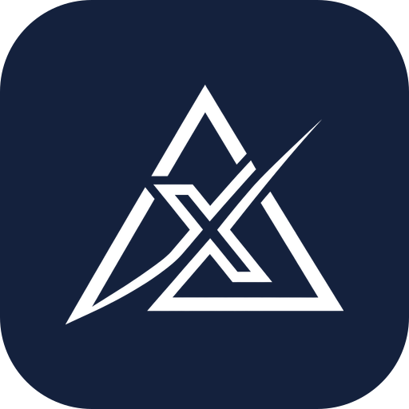

<p align="center"></p>

# Kallr

Every call on X has an after market.

Crypto Twitter runs on calls, and nobody keeps score. Kallr prices every call at the minute it was posted, scores it when its timeframe ends, and lets you copy it with one tap: a real order on Base through Definitive Flash with take-profit and stop-loss attached. You sign in your own wallet; nothing trades without you.

Built at ETHGlobal Mumbai 2026.

## What's here

| Surface | What it does | Status |
| --- | --- | --- |
| **Web app** (`/app`, PWA) | Sign in with X (Privy), wallet on Base, type an order like `copy $5 of ETH tp 10% sl 5%`, sign, and it's placed on Flash with TP/SL. Open orders come back from Flash. | Works against live Flash quotes; first funded mainnet order not run yet |
| **Chrome extension** | On x.com: a trade card under call posts and a Buy button in X's ticker cards, with live prices; the caller's record and a call-check drawer; profile cards, Follow and Following chips; token safety checks on posts that share a contract; orders signed on X with MetaMask/Rabby, or in the desk | Built; loads unpacked |
| **@Kallr on X** | Tag it under a call: replies with the caller's record and this call's after market. Reply `copy $2, TP 10%, SL 5%`: replies with a desk link to sign | Works in dry run on real posts; needs X API keys to go live |
| **Android keyboard** (built on [FlorisBoard](https://github.com/florisboard/florisboard)) | An Kallr row above the keyboard in any app: copy an X post link and see the call's after market and the caller's record; type `copy $5 tp 10% sl 5%` and get a desk link to sign | Built; debug APK, talks to the web app's `/api/keyboard` |
| **Trades dashboard** (`/trades`) | Every order placed from the desk, the extension or the keyboard, and caller records, read in the browser straight from Arkiv | Built; reads live from Arkiv's Rabdi testnet |
| **Safety checks** | Token: honeypot, owner powers, taxes, liquidity, age. Caller: did their wallet sell what they called? | Token checks live (no key); wallet check needs a free Etherscan key |

## Run it

Node 20+ (the repo is tested on Node 24).

```sh
npm install
cp kallr-webapp/.env.example kallr-webapp/.env.local   # add NEXT_PUBLIC_PRIVY_APP_ID, DEFINITIVE_API_KEY
npm run dev                                    # http://localhost:3000
npm test                                       # all packages
```

In the Privy dashboard: enable **Twitter** and **Email** login, enable **embedded wallets** for Ethereum, and add `http://localhost:3000` to allowed origins.

Environment (`kallr-webapp/.env.local`):

| Variable | Needed for | Without it |
| --- | --- | --- |
| `NEXT_PUBLIC_PRIVY_APP_ID` | Sign-in and wallet on `/app` | `/app` shows a setup notice |
| `DEFINITIVE_API_KEY` | Flash quotes and orders | Falls back to Definitive's public dev key |
| `ETHERSCAN_API_KEY` | Caller wallet check | Wallet check reports unavailable; token checks still work |
| `NEXT_PUBLIC_BASE_RPC_URL` | Balances and Chainlink prices | Public Base RPC |

The service worker only registers in production builds: `npm run build && npm start` to test install.

## Placing an order (Definitive Flash)

1. The desk parses the text (`packages/domain/src/order.ts`) and prices TP/SL from Chainlink ETH/USD and BTC/USD on Base.
2. `/api/flash/quote` asks Flash for a quote with an `attachedBracket` (TP/SL). Approvals are sized to the order (`forceMinimalAllowance`), never unlimited.
3. The user's Privy wallet approves if needed and signs the entry and the TP/SL pair.
4. `/api/flash/order` submits; the TP/SL arms on the first fill. The API key stays on the server.

TP/SL attach to buys only (a spot sell leaves you in USDC). Tradable today: ETH (as WETH) and BTC (as cbBTC) against USDC on Base.

## Android keyboard

Phones can't run extensions, but every app has a keyboard. `kallr-keyboard` is a fork of
**[FlorisBoard](https://github.com/florisboard/florisboard)** v0.5.2 (Apache-2.0, by The
FlorisBoard Contributors), which does all the typing. We added one row above its Smartbar:

- Copy a post link in X (Share → Copy link): the call's after market, the caller's record, and a one-tap "Copy $5"
- Type `copy $5 tp 10% sl 5%`: "Sign in desk ↗" opens the desk prefilled; you sign there
- A shared contract address: a token check, no copy button

It never holds keys, sends only the post link, contract or order phrase (nothing else you type),
and stays quiet in password fields. Build, install and what changed:
[kallr-keyboard/KALLR.md](kallr-keyboard/KALLR.md).

## Arkiv: trade records and caller records

Trades run on Base mainnet through Flash. Their records, and every call we price, are stored on
[Arkiv](https://arkiv.network) (testnet Rabdi, chain `7794095`), and `/trades` reads them from Arkiv in the
browser, so anyone can check them without asking us.

| Entity | Written when | Owner | Expires |
| --- | --- | --- | --- |
| `kallr.trades` | Flash accepts an order | Created read-only by our writer, then handed to the trader's wallet | ~182 days (Arkiv's max) |
| `kallr.calls` | We first price a call | Our writer, read-only | Its timeframe plus a 48h scoring window |
| `kallr.call-results` | The call settles (hit, miss or flat) | Our writer, read-only; anyone may extend it | ~182 days, extendable by anyone |

- **Writer wallet:** `0x9bA2Ce7b1c3930d3C82Cb18531F8D4483b393B53`. Reads only trust entities it created.
- **One query you can run:** `arkiv.schema = str('kallr.trades') AND $creator = addr(0x9bA2Ce7b1c3930d3C82Cb18531F8D4483b393B53)`
- Details: [arkiv/schema.md](arkiv/schema.md), [why-arkiv.md](arkiv/why-arkiv.md), [how-you-use-arkiv.md](arkiv/how-you-use-arkiv.md), [reach.md](arkiv/reach.md), [friction.md](arkiv/friction.md).
- Code: `packages/integrations/src/arkiv.ts` (schemas, reads), `kallr-webapp/lib/server/arkiv.ts` (writes), `kallr-webapp/app/trades/page.tsx` (dashboard), `kallr-webapp/app/api/arkiv/score` (settles expired calls).

## Chrome extension

```sh
npm run build -w @kallr/extension                                       # for http://localhost:3000
KALLR_APP_ORIGIN=https://your-app.example npm run build -w @kallr/extension
```

Then `chrome://extensions` → Developer mode → Load unpacked → `kallr-extension/dist`, and open x.com with `npm run dev` running.

What it adds to X:

- **Under call posts:** the caller's record (calls seen in this browser), this call's move since posting, and a trade ticket (amount, TP/SL) that places a Flash order.
- **In X's own ticker cards:** a "⇄ Buy" button with the live price.
- **On profiles:** a profile card with the caller's record and a Follow button; Following chips on bylines. Follows are shared with the desk's Following list.
- **Posts that share a contract address:** a token check card (GoPlus + Dexscreener) and no trade, so a ticker copy is never offered next to a possibly fake token.
- **Signing:** with MetaMask or Rabby right on X, or in the desk popup (Privy) as a fallback.
- **Toolbar popup:** connection status.

It reads only what's on screen: no X API, no cookies. The server classifies and scores.

## Safety checks

`/api/checks` and the extension card use free public sources:

| Check | Source | Key |
| --- | --- | --- |
| Honeypot, mint, hidden owner, owner can change balances, taxes, closed source | [GoPlus Security](https://gopluslabs.io) | None |
| Liquidity, 24h volume, token age, no market on Base | [Dexscreener](https://dexscreener.com) | None |
| Caller bought before posting / sold after (front-running) | [Etherscan API V2](https://docs.etherscan.io/etherscan-v2) on Base | Free `ETHERSCAN_API_KEY` |

Findings are observations, not verdicts. A source that fails is shown as unavailable, never as clean.

```sh
curl -s localhost:3000/api/checks -H 'content-type: application/json' \
  -d '{"token":"0x4ed4E862860beD51a9570b96d89aF5E1B0Efefed"}'
```

## The X bot

Tag @Kallr under a call and it replies with the caller's record and how this call played out. Reply `copy $2, TP 10%, SL 5%` and it answers with a link to the desk, where you review and sign. The bot never trades.

```sh
# Try a reply on any public post, no keys needed (posts nothing):
npm run try -w @kallr/x-bot -- https://x.com/<handle>/status/<id> "copy $2, TP 10%, SL 5%"

# Run the mentions loop (dry run unless X_BOT_POST=1):
cp kallr-xbot/.env.example kallr-xbot/.env   # bot account keys
node --env-file=kallr-xbot/.env --import tsx kallr-xbot/src/main.ts
```

The X API is pay-per-use: about $0.001 per mention read, $0.005 per post read, $0.01 per bot reply ($0.20 if the reply contains a link). Run the loop on an always-on host (Railway, Fly, EC2), not a serverless platform.

## Structure

```
apps/
  web/                Next.js PWA: landing (/), desk (/app), Flash + after market + checks APIs
  extension/          Chrome extension for x.com: trade cards, records, profiles, follow, safety checks
  keyboard/           Android keyboard: FlorisBoard fork with an Kallr row
services/
  x-bot/              @Kallr on X: after market replies, copy links to the desk
packages/
  domain/             order parser, reputation, signals
  integrations/       call scoring, after market, Definitive Flash, Arkiv, safety checks, X API
  database/           Postgres schema, X ID ↔ wallet identity (not wired in yet)
arkiv/                Arkiv schema and judging notes
docs/PLAN.md          what we are building and in what order
```

## Not done yet

- First funded order on Base mainnet (needs a Privy app ID and a few USDC on Base)
- Cancel orders from the desk; live orders stream instead of 15s polling
- Follows on Arkiv (calls and trades are there now); creator pages
- Chainlink CRE workflow that scores expired calls
- Android keyboard: release build and a run on a real phone with the X app

## Built at ETHGlobal Mumbai: what's new and what we reused

This repo was started at the event (first commit 5 Nov 2026). What we brought in:

- **Chrome extension cards:** the post card, ticker Buy button, caller record, call check drawer, profile card and
  follow chips were ported from **Xtrading**, our earlier X trading extension (on Monad, with Kuru and Perpl). At
  the event we moved them onto Base and Definitive Flash, added token safety checks, and wired them to this app.
- **Android keyboard:** a fork of [FlorisBoard](https://github.com/florisboard/florisboard) v0.5.2 (Apache-2.0),
  which does all the typing. We added the Kallr row; the full list of changes is in
  [kallr-keyboard/KALLR.md](kallr-keyboard/KALLR.md).
- **jetpref:** [patrickgold/jetpref](https://github.com/patrickgold/jetpref) (Apache-2.0), vendored at the commit
  FlorisBoard v0.5.2 needs, because its snapshot has expired from Maven Central.

New at the event: the web app and desk, the Flash integration with TP/SL, call scoring, the X bot, the keyboard
row and `/api/keyboard`, the Arkiv data layer and the `/trades` dashboard.

## How we used AI

Much of the code was written with Claude Code (Anthropic's AI coding agent), directed and reviewed by us; those
commits carry `Co-Authored-By: Claude`. The product decisions, sponsor choices and testing on real orders are ours.

## License

[MIT](LICENSE). `kallr-keyboard` (FlorisBoard) and `kallr-keyboard/vendor/jetpref` keep their Apache-2.0 licenses.

## Credits

- [FlorisBoard](https://github.com/florisboard/florisboard) (Apache-2.0): the Android keyboard `kallr-keyboard` is built on.
- [jetpref](https://github.com/patrickgold/jetpref) (Apache-2.0): FlorisBoard's preferences library, vendored.
- [Arkiv](https://arkiv.network): where trade and caller records live.
