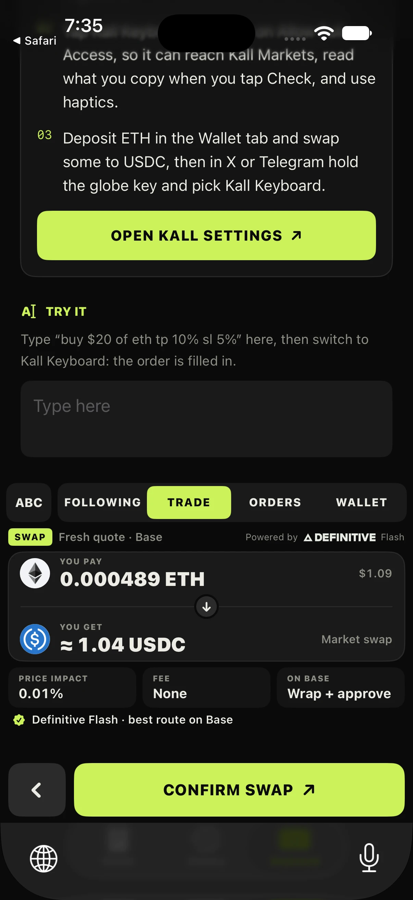
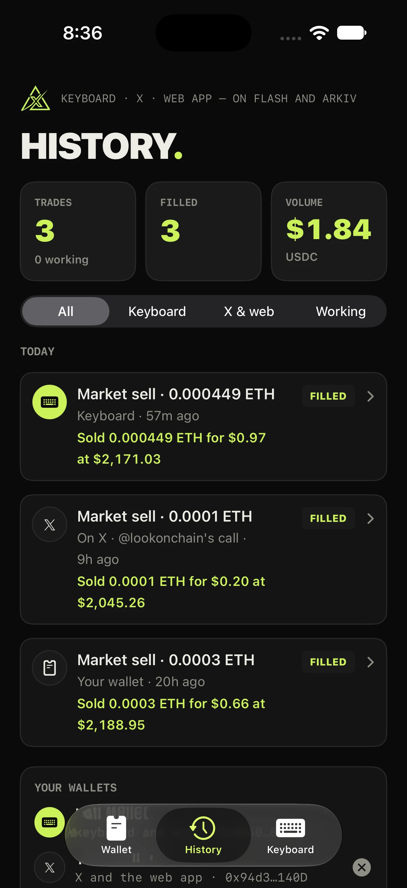
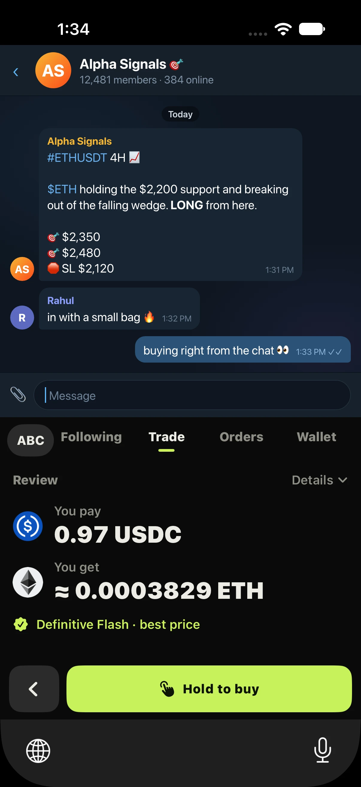
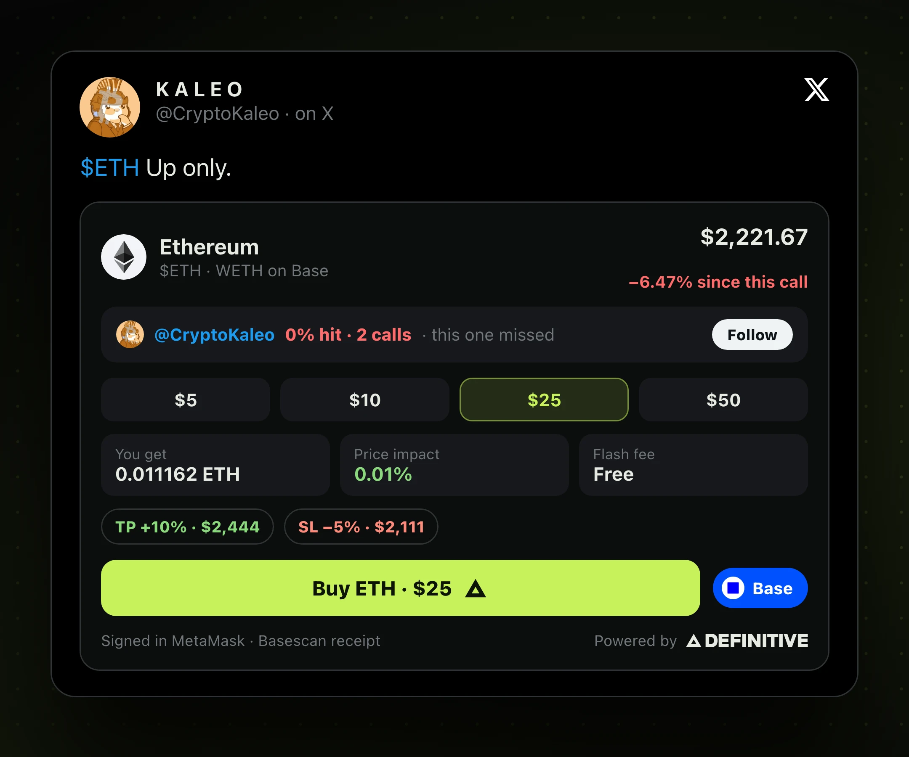
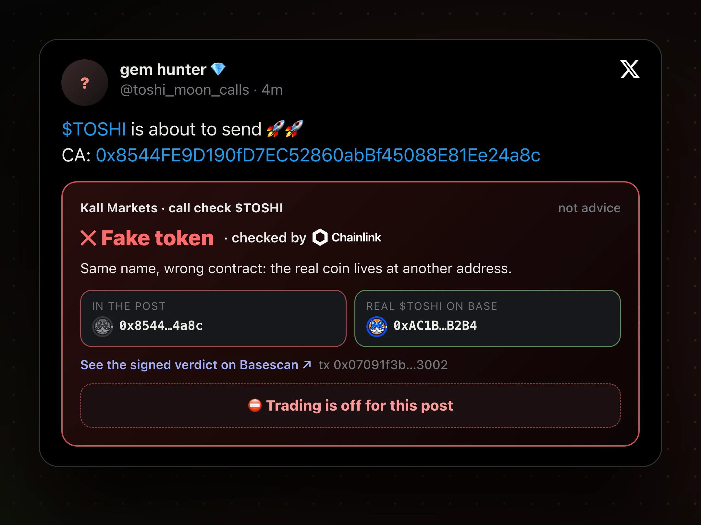
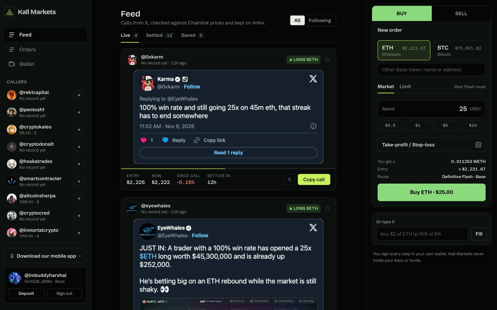
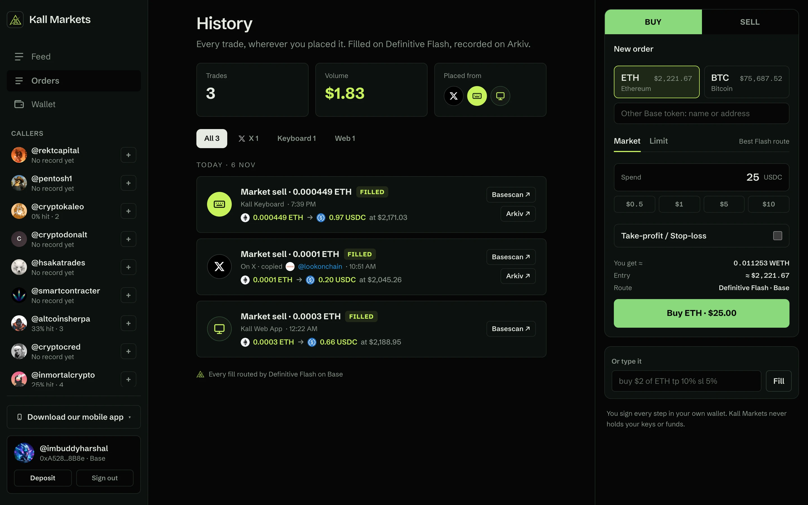
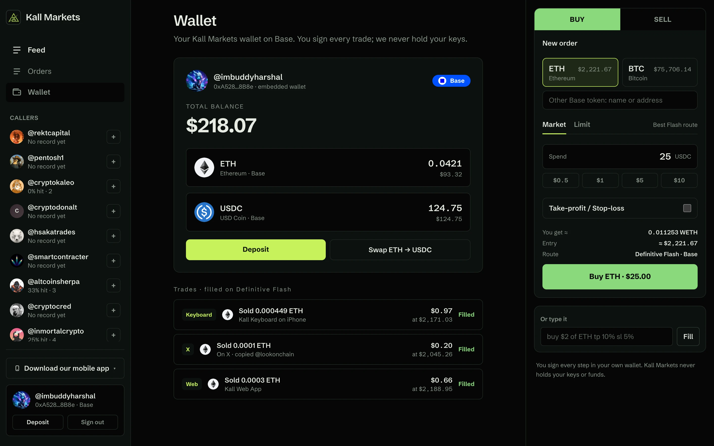
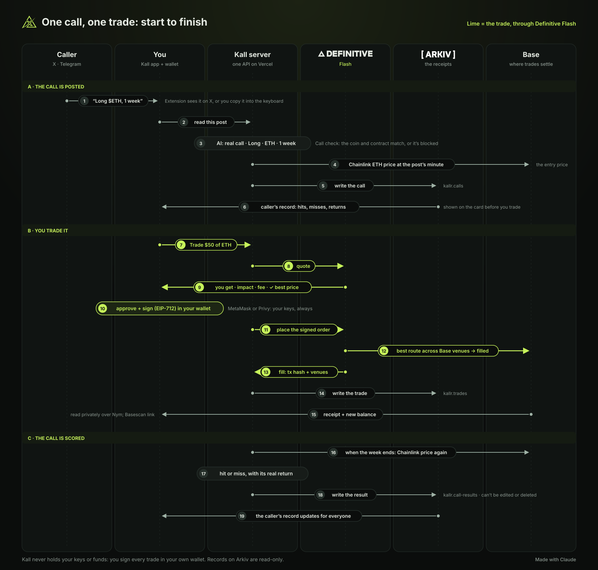

<p align="center"></p>

#  Kall Markets

**Don't trust. Check the caller. Trade it.**

**[kallmarkets.vercel.app](https://kallmarkets.vercel.app)** · [Android app (APK)](https://kall-markets-downloads-308324916322.s3.ap-south-1.amazonaws.com/apps/kall-keyboard.apk) · Built at ETHGlobal Mumbai 2026 · Not financial advice

## Screenshots

<p align="center">
  
  
  
</p>
<p align="center">
  
</p>
<p align="center">
  
  
</p>
<p align="center">
  
  
</p>

## Why we built it

Crypto runs on calls. Someone posts "$ETH, be more bullish" to 300,000 followers, and money moves. If it works,
it becomes a screenshot and an ad for a paid group. If it fails, the post quietly disappears. Followers only see
the wins.

We had already built an extension that let you trade straight from a post on X. Watching people use it, the
trade was the easy part. The first question was always: *is this person ever right?* Nobody could answer,
because the only record lives on the caller's own timeline, where they decide what survives.

So before you can trade a call, Kall Markets shows its receipt.

## What it does

Every call we see is priced at the minute it was posted (Chainlink on Base), scored when its time is up, and
written to [Arkiv](https://arkiv.network) as a read-only record. The post itself is snapshotted to
[Swarm](https://www.ethswarm.org), so deleting the tweet doesn't delete the record. Then you can trade it right
there, through [Definitive Flash](https://definitive.fi) on Base, signed in your own wallet.

| | Where | What you do |
| --- | --- | --- |
| **Kall Web App** | [kallmarkets.vercel.app/app](https://kallmarkets.vercel.app/app) | The feed of real calls with their verdicts, the callers you follow, the trade ticket, your orders and wallet |
| **Kall Extension** | Chrome, on X | A card under every call: the caller's record, a fake-contract check, and a trade you sign without leaving the post |
| **Kall Keyboard** | Android and iPhone, in any chat | Copy a call in Telegram, WhatsApp or X; the keyboard reads it, checks the caller, and trades it in the chat |

<p align="center"></p>

1. **Read.** An AI reader decides if a post is a real call and which way it points. Sarcasm, questions and
   looking back don't count.
2. **Check.** A coin named next to a contract that isn't that coin gets "Call check failed" and no trade.
3. **Price.** Entry is the Chainlink price on Base at the minute of the post.
4. **Trade.** Definitive Flash quotes (price impact, slippage and fee shown first), you sign, it fills on Base,
   and you get the Basescan receipt and the route Flash took.
5. **Record.** The call, its snapshot and the trade go to Arkiv and Swarm.
6. **Score.** When the call's time is up it's a hit or a miss with its real return, and the caller's record
   updates everywhere.

## What each sponsor does here

- **Definitive Flash: every trade.** Market, limit and TWAP orders with take-profit and stop-loss attached.
  Approvals are sized to the order, never unlimited; the API key stays on our server. Code:
  [`definitive.ts`](packages/integrations/src/definitive.ts), [`/api/flash`](kallr-webapp/app/api/flash).
  Our notes for the team: [feedback/definitive.md](feedback/definitive.md).
- **Arkiv: the receipts.** Calls, results, trades and the callers we track, read-only so nobody can edit a miss,
  and readable by anyone without asking us. The whole story, schema and what got in our way:
  **[arkiv/README.md](arkiv/README.md)**.

Also: Chainlink price feeds on Base (entry and exit prices), Privy (sign in with X, embedded wallet), GoPlus and
Dexscreener (token checks).

## Proof it runs

Everything Kall writes is created by one wallet, `0x9bA2Ce7b1c3930d3C82Cb18531F8D4483b393B53`, on Arkiv's
Rabdi testnet. Anyone can list it:

```
arkiv.schema = str('kallr.call-results') AND $creator = addr(0x9bA2Ce7b1c3930d3C82Cb18531F8D4483b393B53)
```

A few real calls from X and how they ended:

| Post on X | Result | Arkiv |
| --- | --- | --- |
| [@AltcoinSherpa: "Time to pump $SOL"](https://x.com/AltcoinSherpa/status/2117629619637809255) | SOL hit +1.20% | [`0x4b9dcd3b…`](https://rabdi.explorer.arkiv.network/tx/0x4b9dcd3bce0f23436abd1de694048e7beb93a848718be564c481ca7760b40ed1) |
| [@inmortalcrypto: "accumulate … $BTC"](https://x.com/inmortalcrypto/status/2112240301758964212) | BTC hit +1.23% | [`0xf597d7db…`](https://rabdi.explorer.arkiv.network/tx/0xf597d7db8fef9635721523a6894b33b17927fce93439b3a97177d736a0d90a57) |
| [@CryptoKaleo: "$ETH Up only."](https://x.com/CryptoKaleo/status/2118005120076234811) | ETH miss −6.47% | [`0xe1488385…`](https://rabdi.explorer.arkiv.network/tx/0xe14883858ab96299246ca9bf4b4bbcecc4c97f3336aeebb1e5087bcdca80daf4) |
| [@CryptoKaleo: "$100K+ IS A MAGNET"](https://x.com/CryptoKaleo/status/2118004723597169006) | BTC miss −5.11% | [`0x5346935d…`](https://rabdi.explorer.arkiv.network/tx/0x5346935d9436733485fd9be452f14d3ba05d18a38b60cccf1c7dad0ede1af769) |

Yes, the famous accounts miss a lot. That's the point.

## Run it

```sh
npm install
cp kallr-webapp/.env.example kallr-webapp/.env.local   # NEXT_PUBLIC_PRIVY_APP_ID, DEFINITIVE_API_KEY
npm run dev                                            # http://localhost:3000
npm test
```

- **Extension:** `npm run build -w @kallr/extension`, then `chrome://extensions` → Load unpacked → `kallr-extension/dist`.
- **Android keyboard:** [download the APK](https://kall-markets-downloads-308324916322.s3.ap-south-1.amazonaws.com/apps/kall-keyboard.apk), or build it: [kallr-keyboard/KALLR.md](kallr-keyboard/KALLR.md).
- **iPhone keyboard:** build from Xcode: [kallr-ios/README.md](kallr-ios/README.md).

Every variable is listed in [`kallr-webapp/.env.example`](kallr-webapp/.env.example). Without the optional
keys the app still runs; the feature that needs one says so.

```
kallr-webapp/      Next.js web app and API (landing, /app, /trades)
kallr-extension/   Chrome extension for X
kallr-keyboard/    Android keyboard (FlorisBoard fork)
kallr-ios/         iPhone app and keyboard (SwiftUI)
kallr-swarm/       the /trades dashboard as a static page on Swarm
packages/          order parsing, call scoring, Definitive, Arkiv, checks
arkiv/             everything about how we use Arkiv
```

## Not done yet

- The iPhone keyboard trades from a small demo wallet our server holds (capped per order), not the user's own.
- The Swarm dashboard page waits for the public gateway's approval; the post snapshots themselves are served.
- The X bot works in dry run; we're not running it live.

## What we reused

The repo started at the event (first commit 5 Nov 2026). The extension's post card, ticker button and caller
record were ported from **Xtrading**, our earlier X trading extension on Monad, and moved onto Base and
Definitive Flash here. The landing's particle background and the black-and-lime look come from the same project.
The Android keyboard is a fork of [FlorisBoard](https://github.com/florisboard/florisboard) v0.5.2 (Apache-2.0);
what we added is in [KALLR.md](kallr-keyboard/KALLR.md).

Much of the code was written with Claude Code, directed and reviewed by us; those commits carry
`Co-Authored-By: Claude`.

## License

[MIT](LICENSE). `kallr-keyboard` (FlorisBoard) and its vendored `jetpref` keep their Apache-2.0 licenses.
