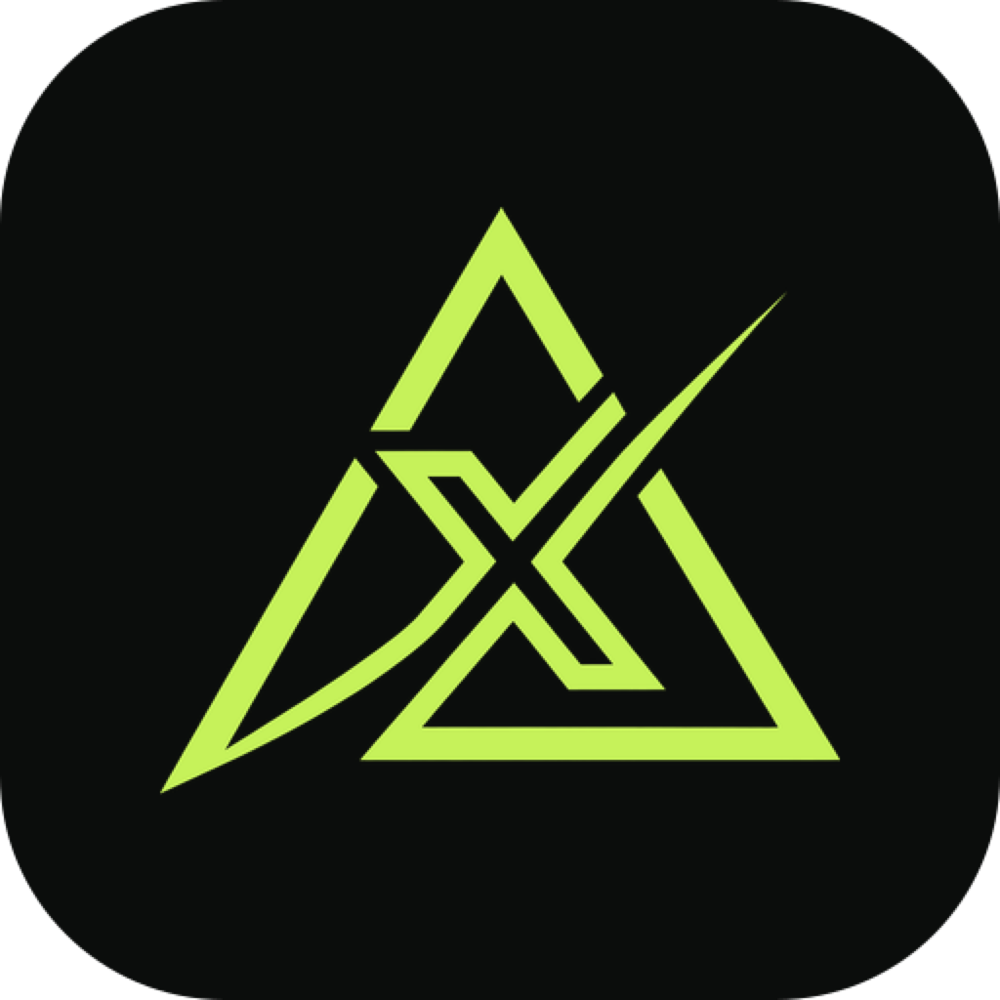

# Kall Keyboard for iPhone

A small app plus the Kall Keyboard extension, in Kall Markets black and lime. The keyboard types like the
iPhone keyboard (letters, 123, #+=, shift and caps lock, space, return, auto-capitals, a double space for
". ", hold to delete), and where the emoji key would be there's the Kall key: our logo with TRADE under
it. It opens the trading panel below; ABC goes back to typing. A strip above the letters shows the
newest calls from callers you follow (tap one to trade it), an order you're typing, and the clipboard
check. **Paste** puts what you copied into the chat; when it's a call (an X post, a `$TICKER`, a contract,
or a Telegram-style `#SOLUSDT` post with 🎯 targets) Trade opens with the coin filled in, the first target
above the price as the take-profit and the call's stop, or a tight −5%, as the stop-loss. A call pasted
with iOS's own Paste opens Trade the same way. Each key has its own haptic (letters, space, delete, shift, caps lock, 123, the Kall key); iOS
plays keyboard haptics only with Allow Full Access.

- **Following:** calls from the callers you follow (kept on the phone), read from Arkiv by
  `/api/keyboard/feed`: the post's text from its Swarm snapshot, the move since the post, time left, and
  **Trade**. Each call shows the hash of its Arkiv record; open the call and tap the record to see it on
  Arkiv's explorer. Chips for the callers you follow, with their hit rates, open each caller's page;
  Active and Settled filter the list.
  **Explore** lists every caller Kall Markets tracks or has priced, with their record and Follow. A
  caller's page (from `/api/callers/<handle>`) has every call they made: open ones with time left, closed
  ones in a "Closed calls" dropdown, each row call | result | Arkiv ↗ | X ↗, and how many of their posts
  are deleted on X. The clipboard button checks a post or $TICKER message you copied.
- **Trade:** laid out like a swap. **You pay** is dollars of USDC (tap to type, with $1, $5, $10, $25 and
  Max; the Kall wallet's balance beside it); **You get** is the coin, about how much, and the price it
  buys at. Tap the coin to pick another, like a swap's token list: ETH and BTC up top, then type a name or
  symbol on the keyboard's own keys, or paste a contract address, and Definitive's search lists what Flash
  trades on Base (logo, price, liquidity; risky tokens are marked and refused). The review shows
  "Best price: ✓ Definitive Flash · best route on Base"; orders go only to Flash. Market, Limit or TWAP is a small toggle; take-profit and stop-loss fold into Advanced (with the
  limit offset, −1 to −10%, or the TWAP length, 10 minutes to 12 hours) and show where they'd sell. **Review** gets a fresh
  Definitive Flash quote (you pay, you get, price impact and fee, exits, approval) without sending
  anything; **press and hold** the lime button to send it (letting go early cancels).
- **Orders:** the Kall wallet's Flash orders with live status (re-read every 5 seconds while one is
  working), which call each one copied, its Arkiv trade record (a seal in the list; the hash and a link
  in the order), and **Cancel** for working limit and TWAP orders. After a trade, the done screen shows
  the Arkiv record once the server writes it, and **Open on Basescan** opens the fill in Safari. Cancelling is
  Flash's gasless signed message and is final.
- **Wallet:** the Kall wallet's address and balances.

**Your Kall wallet.** Wallet › **Sign in with X** opens the web app's `/app/keyboard-link`: sign in with X,
allow Kall's signer once, and the app opens with `kallmarkets://link?key=…&address=…&expires=…`. The key is
kept in a keychain group the app and the keyboard share, and every keyboard call carries it, so the
keyboard trades, swaps and cancels from the same Privy wallet as X and the web app, signed on the server by
Kall's Privy signer and capped per order. Funds left in the old shared keyboard wallet move over with
**Move to your Kall wallet**.

**How a trade is placed.** The keyboard sends the order to `/api/keyboard/execute` with your Kall wallet's
key (or, before you link, a secret only these builds carry, for the shared demo wallet). The server
re-quotes on Flash, approves exactly this USDC amount, signs and submits, then records the trade on Arkiv as
a keyboard trade, with a per-order cap ($25).
An order typed on the iPhone keyboard ("buy $20 of eth tp 10% sl 5%") is filled in when you switch to Kall.

iOS doesn't let keyboards use the microphone, so voice orders are Android only.

## The app

- **Wallet:** the Kall wallet's ETH and USDC, its address (copy, or open it on BaseScan), the latest
  orders and the best callers by settled hit rate.
  **Deposit** (ETH or USDC) picks an amount, then copies the Kall wallet's address, opens a wallet
  app with the transfer on Base filled in (an EIP-681 link), or shows it as a QR code for Rainbow or any
  wallet. Balances are read again when you come back from the wallet, and a deposit that landed is called
  out. **Withdraw** sends ETH or USDC to an address on Base: Review checks it without sending, then hold
  to send (`/api/keyboard/withdraw`, up to `KALL_EXEC_MAX_WITHDRAW_USD`, $100, per withdrawal; ETH keeps a
  little for gas).
- **Swap ETH to USDC:** type dollars (or $5, $10, $25, Max), review a fresh Definitive Flash quote, confirm.
  The server (`/api/keyboard/swap`) sells that much of the Kall wallet's ETH for USDC: Flash's wrap to
  WETH, an approval for exactly that amount, then the signed order. About $1 of ETH always stays for gas,
  and one swap goes up to `KALL_EXEC_MAX_SWAP_USD` ($100). The keyboard's buys spend the USDC.
- **History:** every Flash order the Kall wallet placed: totals, All / Working / Done, what each one filled
  at, and a detail sheet with the Flash order ID, the call it copied, whether the trade is recorded on
  Arkiv, and Cancel while it's working. Re-read every 5 seconds while an order is working.
- **Keyboard:** setup steps and three Telegram calls to copy: an ETH long with targets, a fake contract
  Chainlink CRE blocks, and a real one it confirms.

Debug builds can read from a local server and show another wallet's orders, for testing History before
the Kall wallet has traded:

```sh
xcrun simctl spawn booted defaults write com.buddyharshal.kallr kall.origin http://localhost:3004
xcrun simctl spawn booted defaults write com.buddyharshal.kallr kall.funder 0x…
```

## Build and install

Needs Xcode, [XcodeGen](https://github.com/yonaskolb/XcodeGen) (`brew install xcodegen`), an Apple ID in
Xcode (a free Personal Team works; its installs expire after 7 days) and the iPhone connected with
Developer Mode on. Set `DEVELOPMENT_TEAM` in `project.yml` to your team ID, and create the git-ignored
`Shared/Secrets.swift` with the server's `KALL_EXEC_TOKEN`:

```sh
printf 'enum Secrets {\n    static let execToken = "%s"\n}\n' "$KALL_EXEC_TOKEN" > kallr-ios/Shared/Secrets.swift
```

Then:

```sh
cd kallr-ios
xcodegen generate
xcodebuild -project Kallr.xcodeproj -scheme Kallr -destination 'id=<iPhone UDID>' \
  -derivedDataPath build -allowProvisioningUpdates -allowProvisioningDeviceRegistration build
xcrun devicectl device install app --device <iPhone UDID> build/Build/Products/Debug-iphoneos/Kallr.app
```

`xcrun devicectl list devices` shows the UDID. Or open `Kallr.xcodeproj` and press Run.

## On the iPhone

1. **Settings → General → VPN & Device Management →** your Apple ID under Developer App **→ Trust**.
2. **Settings → General → Keyboard → Keyboards → Add New Keyboard → Kall Keyboard.**
3. Tap **Kall Keyboard** and turn on **Allow Full Access**, so it can reach Kall Markets and read what you copy when you
   tap Check.
4. In any app, hold the globe key and pick Kall Keyboard.
